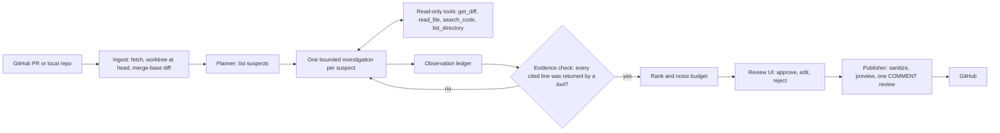

# PR Investigator

An evidence-driven AI reviewer for GitHub pull requests. Instead of sending a diff to an LLM and posting whatever comes back, it forms hypotheses about a PR, investigates each one with read-only tools over the repository, checks every claim mechanically against the code, and lets a human decide what gets posted as a GitHub review.

- **Evidence before claims.** A finding is reportable only if each piece of evidence points at a line range that a tool actually returned during that investigation. The check is deterministic and runs against the analyzed commit. The code snippets you see are re-read by the system, never copied from model output.
- **Untrusted by default.** The PR, its title, comments, commit messages and even `AGENTS.md` / `CLAUDE.md` in the target repository are data, never instructions. The agent has no shell, no network, no write access and no credentials.
- **Human in the loop.** Nothing reaches GitHub until a person approves it. Publishing is a separate, gated component that posts one `COMMENT` review using a fixed template and sanitized text.
- **Precision over recall.** At most 7 comments per PR, medium severity or higher. "Inconclusive" beats a speculative finding.
- **Runs on a free model tier.** Development and evaluation use Gemini's free tier. Paid providers are disabled unless you opt in.

> **Status.** Everything is built and tested offline: PR ingestion, read-only tools, five reviewers, the evidence ledger, a review UI, a gated publisher, an evaluation suite with results, and a hosted GitHub App service. The local flow (`pri review` → `pri serve` → approve → post) has been run end to end on a real pull request. The hosted GitHub App service (Phase 6) is tested against a mocked GitHub only; it has not been deployed or run against a real App. See [Limitations](#limitations).

## Contents

1. [How it works](#how-it-works)
2. [Results](#results)
3. [Quick start](#quick-start)
4. [Using it](#using-it)
5. [Configuration](#configuration)
6. [The review UI and publishing](#the-review-ui-and-publishing)
7. [The evaluation suite](#the-evaluation-suite)
8. [The hosted service](#the-hosted-service)
9. [Repository layout](#repository-layout)
10. [Development](#development)
11. [Security model](#security-model)
12. [Limitations](#limitations)
13. [Troubleshooting](#troubleshooting)
14. [Documentation](#documentation)

## How it works



1. **Ingest.** A public PR URL (through the GitHub REST API and a hardened `git fetch`) or a local repository with base and head refs. A worktree at the head commit and the merge-base diff are built once per run.
2. **Plan.** The planner reads the diff and lists up to four suspected problems, each with where it is and how to check it.
3. **Investigate.** One short agent loop per suspect, with at most 6 model turns, calls read-only tools. Every tool result lists the *observations* (file and line ranges) the model may cite.
4. **Verdict.** The agent submits `confirmed`, `refuted` or `inconclusive`. A submission that cites a line no tool showed, or cites absence evidence from a search that found matches, is rejected with a message saying what to cite instead, and the agent gets a chance to fix it.
5. **Rank.** Confirmed findings are ranked by severity and verification strength, and capped by the noise budget.
6. **Decide and publish.** A human reviews findings, their evidence and the full trace in a local UI. Approved findings are rendered through a sanitizer and secret scanner and posted as one review on the analyzed commit.

Every run is traced: model IDs, prompt versions, budgets, each LLM call and each tool call are persisted, and `pri show` turns a trace into a readable timeline.

### The reviewers

| Reviewer | What it does | Typical cost per PR |
|---|---|---|
| `a2` (default) | Planner, then one bounded investigation per suspect | up to about 26 requests (mean about 7) |
| `a1` | One agent loop over the whole PR | up to 12 requests (mean about 6) |
| `a3` | `a2`, then an independent skeptic tries to refute each finding | `a2` plus about 3 requests (opt-in) |
| `b0` | One model call on the diff, no tools (the baseline) | 1 request |
| `b1` | `b0` plus a deterministic context pack (callers, callees and tests of changed Python functions) and mechanical leads | 1 request |

Options on top: `--tools structural` adds five tree-sitter-backed tools (`find_symbol`, `find_references`, `get_symbol_context`, `find_tests`, `git_history`) for `a1` and `a2`; `--context` gives `a1` the same context pack as `b1`. Both are opt-in because the ablations showed no measurable gain.

## Results

Held-out test split of the evaluation suite: 15 cases, 3 samples each, `gemini-3.5-flash-lite` on the free tier, scored by location only. Intervals are 95% bootstraps that resample whole cases, so with 15 cases they are wide. The suite is small; read the ordering, not the decimals. Full table, caveats and the decision for every component are in [evals/results/README.md](evals/results/README.md).

| Test split, 3 samples | B0 | B1 | A1 | A2 (default) | A3 |
|---|---|---|---|---|---|
| Precision | 81% | **100%** | 75% | 81% | 83% |
| Recall (95% CI) | 44% (21–62%) | 44% (20–62%) | 23% (0–43%) | **64% (45–81%)** | 64% (45–81%) |
| False positives per clean PR | 0.50 | 0.00 | 0.00 | 0.00 | 0.00 |
| Requests per true positive | 2.6 | 2.6 | 28.3 | 13.0 | 18.4 |

What this says:

- **Agentic investigation (A2) finds the most issues**, especially ones that need code outside the diff. Its planner is what helps; one unstructured agent loop (A1) did worst.
- **B1 is the cheap, precise option**: one request, no false positives, with the deterministic context pack doing the work.
- **The skeptic verifier (A3) and the structural tools did not earn their place** on this model, so they are opt-in.
- **A2 flags decoys more often** (4 of 9 decoy runs) than B0 and B1. The severity rule removes most low-severity ones before posting, but the raw agent is more speculative.
- **Security:** 0 canary leaks and 0 surviving injections through the output layer, against a scripted model that obeys every attack ([evals/results/security.md](evals/results/security.md)). How often a real model resists an injection is not measured.

## Quick start

You need: **git**, **[ripgrep](https://github.com/BurntSushi/ripgrep)** and **[uv](https://docs.astral.sh/uv/)** (which installs Python 3.13 for you).

```bash
# macOS:   brew install ripgrep uv
# Debian:  sudo apt-get install ripgrep   (uv: https://docs.astral.sh/uv/getting-started/installation/)

git clone https://github.com/keshavm21/pr-investigator.git
cd pr-investigator
uv sync                    # installs everything into .venv
cp .env.example .env       # then edit .env, see below
uv run pri doctor          # checks the setup without calling any API
```

**Get a free Gemini key** at [Google AI Studio](https://aistudio.google.com/apikey) and put it in `.env` as `GEMINI_API_KEY`. Use a key from a project **without billing**, so going over the free quota fails with a 429 instead of costing money.

**Try it with no API key at all.** The committed evaluation traces replay offline:

```bash
uv run pri show evals/results/20261017-092740-a1-gemini-3.5-flash-lite/traces/seeded-broken-caller-signature-s1.jsonl
uv run pri eval validate        # checks all 34 evaluation cases end to end; no LLM calls
uv run pytest                   # the whole test suite, offline
```

**Review a real PR** (this spends free-tier quota, up to about 26 requests):

```bash
uv run pri review https://github.com/OWNER/REPO/pull/123
```

> **Public repositories only on the free tier.** Google may use free-tier inputs for training, so PR Investigator refuses to send a private repository's code to it. For a local repository you must say so with `--data-class public`.

## Using it

### Review

```bash
uv run pri review https://github.com/OWNER/REPO/pull/123          # default reviewer: a2
uv run pri review OWNER/REPO#123                                   # short form
uv run pri review URL --reviewer a1                                # one agent loop
uv run pri review URL --reviewer b1                                # one call plus context pack
uv run pri review URL --tools structural                           # add the tree-sitter tools
uv run pri review URL --json                                       # machine-readable result

# A local repository (no GitHub needed). Say who may see the code:
uv run pri review ./my-repo --base main --head my-branch --data-class public \
    --title "Add caching" --description "Adds an LRU cache to the loader"
```

Set `GITHUB_TOKEN` in `.env` to raise GitHub's API rate limit for public repositories (`GITHUB_TOKEN=$(gh auth token)` works). `--max-requests` caps the real provider requests of one run (default 30); cache hits are free.

Each run is saved under `.pri/runs/<run-id>/`: `run.json` (everything, including findings and evidence), `trace.jsonl` (every model and tool call) and `review.md` (the sanitized comments that would be posted).

### Inspect a run

```bash
uv run pri show RUN_ID            # timeline: plan, each investigation's turns, evidence, findings
uv run pri show RUN_ID --full     # include full tool output
```

### Review and post

```bash
uv run pri serve                              # local UI; prints a one-time sign-in token
uv run pri publish RUN_ID --approve F1        # preview the GitHub review for finding F1 (posts nothing)
uv run pri publish RUN_ID --approve F1 --post # really post it (needs GITHUB_TOKEN with PR write access)
```

See [the next section](#the-review-ui-and-publishing).

## Configuration

Settings come from environment variables or `.env`. Provider and model are configuration, not code: all review code talks to an internal `LLMClient` interface.

| Variable | Default | Meaning |
|---|---|---|
| `GEMINI_API_KEY` | none | Gemini key (`GOOGLE_API_KEY` also works) |
| `GITHUB_TOKEN` | none | Raises the GitHub rate limit; needed to post reviews |
| `PRI_LLM_PROVIDER` | `gemini` | `gemini`, or `fake` (offline scripted adapter used in tests) |
| `PRI_LLM_MODEL` | see note | Model name. `.env.example` sets `gemini-3.5-flash-lite`, which the evaluation results use. The code default is a different model, so keep the line from `.env.example`. |
| `PRI_LLM_REQUESTS_PER_MINUTE` | `5` | Client-side rate limit. Use `10` for evaluation runs on the free tier. |
| `PRI_LLM_CACHE_MODE` | `read_write` | LLM response cache: `read_write`, `replay` (never call the API) or off |
| `PRI_LLM_MAX_RETRIES` | `3` | Retries for transient provider errors |
| `PRI_ALLOW_PAID_PROVIDERS` | `false` | Paid adapters stay disabled unless you set this |
| `PRI_DATA_DIR` | `.pri` | Runs, git mirrors, workspaces and the response cache |
| `PRI_MAX_DIFF_CHARS` | `200000` | Largest diff the reviewer accepts |

The **response cache** (`.pri/cache/llm`) replays identical requests for free, which makes re-running an evaluation or a review cheap. Delete it to force fresh calls.

Behaviour-changing repository settings (`.pr-investigator.yml`: ignore paths, generated files) are read from the **base branch**, never from the PR head, so a PR cannot change how it is reviewed.

## The review UI and publishing

`pri serve` starts a local web app (FastAPI and Jinja2, no JavaScript, strict Content-Security-Policy). It prints a sign-in token; paste it at the login page.

- **Runs list and run page:** finding cards with severity and confidence badges, whether each is inside the noise budget, and the evidence with code snippets re-read from the repository.
- **Trace viewer:** every turn, tool call and evidence check of the investigation.
- **Decisions:** approve, edit (title, explanation, severity, fix) or reject with a reason code. Decisions are stored in `.pri/review.sqlite`.
- **Publish preview:** the exact payload that would be sent, the destination repository, and whether the PR has moved since the analysis. Nothing is sent until you press the confirm button.

The publisher posts **one `COMMENT` review** on the analyzed commit as the owner of `GITHUB_TOKEN`, never approve or request-changes. It adds an idempotency marker (posting twice is blocked), falls back to a summary-only review if GitHub rejects a line anchor (422), and refuses if the PR has new commits.

**Token for posting:** a fine-grained personal access token limited to the one repository, with *Pull requests: Read and write* and *Contents: Read*. If a post is refused with 403, check that the run you approved belongs to the repository the token covers: the publish page shows a "Destination" line.

## The evaluation suite

34 cases built as small edits to two fixtures: a synthetic `inventory_service` and a vendored, unmodified [Werkzeug](https://github.com/pallets/werkzeug) 3.1.9 snapshot (BSD-3-Clause). Cases are seeded bugs, decoys (code that looks wrong but is safe for a reason outside the diff) and clean PRs, split into dev (19) and test (15). Report results on the test split only and never tune on it.

```bash
uv run pri eval list --split test
uv run pri eval validate                                   # no LLM calls
uv run pri eval run --case seeded-sql-injection-search --samples 1   # uses free-tier quota
PRI_LLM_REQUESTS_PER_MINUTE=10 uv run pri eval run --split test --reviewer a2 \
    --samples 3 --no-judge --max-requests 300              # about 220 real requests
uv run pri eval report B0=evals/results/20261022-b0-test3 A2=evals/results/20261022-a2-test3
```

`pri eval report` builds the ablation table with bootstrap intervals, cost per true positive and latency from result directories. Replays of committed runs are free, because identical requests hit the response cache; note that sample 0 of a new run can repeat an earlier run exactly. Metrics and datasets are defined in [docs/evaluation.md](docs/evaluation.md).

## The hosted service

`pri service` and `pri worker` run the tool as a **GitHub App**: a webhook queues an analysis when a PR opens on an allowlisted repository, and people with write access sign in with GitHub, approve, and post as the App. The design has two trust zones: a *fetch* worker holds the App key; the *analyze* worker holds only the LLM key and refuses GitHub credentials. There is a `Dockerfile`, a `compose.yaml` with Caddy for HTTPS, and a step-by-step [runbook](docs/runbook.md).

This part is **built and tested against a mocked GitHub only**. Nobody has deployed it against a real App yet, so expect to fix small things the first time.

## Repository layout

```text
src/pr_investigator/
  cli.py                 the `pri` command
  config.py, domain.py   settings and the core models (Finding, Anchor, ReviewTarget)
  github.py, ingest.py, workspace.py, diff.py   PR ingestion, worktrees, diff parsing
  tools/                 read-only agent tools (read_file, search_code, get_diff, ... plus structural ones)
  index/                 tree-sitter index of Python code (SQLite)
  agent/                 the bounded loop, ledger, evidence check, planner, investigators, skeptic
  review/                reviewers, context pack, ranking and noise budget, comment rendering
  llm/                   LLMClient interface, Gemini adapter, fake adapter, cache, rate limiting
  evaluation/            case loading, matching, metrics, runner, report
  publish.py             the gated GitHub publisher
  web/                   the review UI (FastAPI, Jinja2, strict CSP)
  service/               the hosted GitHub App service (Phase 6)
  prompts/               versioned prompt files
evals/                   cases, fixtures and committed results
docs/                    architecture, security, evaluation, plan, decisions, runbook
deploy/                  Caddyfile and env templates
tests/                   unit, integration and (skipped by default) live tests
```

## Development

```bash
uv run pytest                              # all tests, offline (live tests are skipped)
uv run pytest tests/unit/test_diff.py      # one file
uv run ruff check . && uv run ruff format --check .
uv run mypy                                # strict, src/ only
PRI_LIVE_TESTS=1 uv run pytest tests/live -m live   # a few real Gemini calls; spends quota
```

CI (`.github/workflows/ci.yml`) runs lint, type check and tests on every push and PR, with no secrets. Rules the code follows:

- **Tests and CI never call live LLM or GitHub APIs.** They use the `fake` and `replay` adapters and mocked HTTP. A test fixture strips API keys so a real key in `.env` can't spend quota.
- **The pipeline is provider-neutral** and uses no agent framework; the investigation is a small bounded loop on `LLMClient`.
- **Prompts are versioned files.** Changing one changes the prompt version recorded with each run, and changes response-cache keys. Tool schemas and `LLMRequest` defaults are cache keys too.
- Agent conversations are append-only.

Architecture, decisions and the plan live in [docs/](docs/). Decisions that changed are recorded in [docs/decisions.md](docs/decisions.md).

## Security model

Summary (full threat model in [docs/security.md](docs/security.md)):

1. **Nothing to hijack.** The agent's tools only read, are confined to the run's worktree and refuse path or symlink escapes. It never executes repository code.
2. **Evidence gate.** A claim without tool-returned evidence cannot become a finding, however persuasive an injected instruction is.
3. **Output sanitizing.** Posted text passes a sanitizer (no HTML, images, external links or mentions) and a secret scanner. A model that obeys every injection still cannot get a link, image or secret into a comment.
4. **Separate, gated publishing.** Only the publisher posts, only approved findings, only `COMMENT` reviews.
5. **Config from the base branch,** never from the PR head.
6. **Hosted mode:** HMAC-checked webhooks, per-job down-scoped installation tokens, an analyzer with no GitHub credentials, GitHub OAuth with a write-access check per run, in-process rate limits.

If you find a security issue, please open a private security advisory on this repository (Security tab) rather than a public issue.

## Limitations

- **A small evaluation suite:** 15 test cases, so the confidence intervals are wide, and location-only scoring undercounts some correct findings. Werkzeug is known to models from training, though the seeded bugs are new.
- **Small free-tier model:** the skeptic verifier's null result may not transfer to a stronger model. Everything was measured on `gemini-3.5-flash-lite`.
- **A reachability rule:** an unsafe construct that no code path in the repository uses (for example a query builder nothing executes) is reported as refuted, not as a finding. Add a caller, or expect "inconclusive".
- **Python only** for the structural index and context pack.
- **No suggestion blocks:** the proposed fix is text, not replacement code.
- **No live injection evaluation:** injection resistance is tested offline with scripted models, not measured on the real model.
- **The hosted service is unverified against a real GitHub App.** Rate limits are in-process and per peer address, and reset on restart. The queue is SQLite, not Postgres.
- **`search_code` ordering:** matches are sorted before truncation, so reviews recorded before that change may not replay from the cache for searches with more than 30 matches.

## Troubleshooting

| Symptom | Cause and fix |
|---|---|
| `ModuleNotFoundError: No module named 'pr_investigator'` on macOS | The checkout is in an iCloud-synced folder (Desktop or Documents). iCloud hides everything in dot-folders and Python 3.13 skips hidden `.pth` files. Move the checkout elsewhere (for example `~/Developer`) and run `rm -rf .venv && uv sync`. If it must stay, keep the environment in `venv.nosync/` and symlink `.venv` to it: `UV_PROJECT_ENVIRONMENT=venv.nosync uv sync && ln -s venv.nosync .venv`. |
| HTTP 429 or "quota exhausted" from Gemini | You hit the free tier's per-minute or daily limit. Wait, lower `PRI_LLM_REQUESTS_PER_MINUTE`, or re-run: finished requests replay from the cache for free. |
| "refusing to send private content" | The target is private or `--data-class` is `private` (the default for local repos). The free tier may train on inputs; use `--data-class public` only for code you are happy to share. |
| `GitHub refused the review (403)` | The token lacks *Pull requests: write* on that repository, or the run you approved is for a different repository. Check the "Destination" line on the publish page, and restart `pri serve` after editing `.env`. |
| `GitHub returned 404` for a PR | The PR does not exist, or the repository is private and the token cannot see it. |
| A review finishes with 0 findings | Open the trace (`pri show RUN_ID`). Common reasons: the suspect was refuted or inconclusive by design, or the problem is not reachable from the repository's code. |
| Segfault while indexing | tree-sitter is pinned below 0.26 on purpose (0.26.0 corrupts the heap on large files). Run `uv sync` to restore the pin. |
| `rg` not found | Install ripgrep and make sure it is on `PATH`; `pri doctor` shows what it found. |

## Documentation

- [Architecture](docs/architecture.md): components, pipeline, tools, data model, stack
- [Security and threat model](docs/security.md)
- [Testing and evaluation](docs/evaluation.md)
- [Evaluation results](evals/results/README.md) and [security results](evals/results/security.md)
- [Implementation plan](docs/implementation-plan.md): phases, scope and status
- [Decision register](docs/decisions.md)
- [Runbook for the hosted service](docs/runbook.md)
- [Demo walkthrough](docs/demo.md)
- [Research notes](docs/research.md)

## License

MIT. See [LICENSE](LICENSE). The vendored Werkzeug snapshot under `evals/fixtures/werkzeug` is BSD-3-Clause; its licence file is kept with it.
